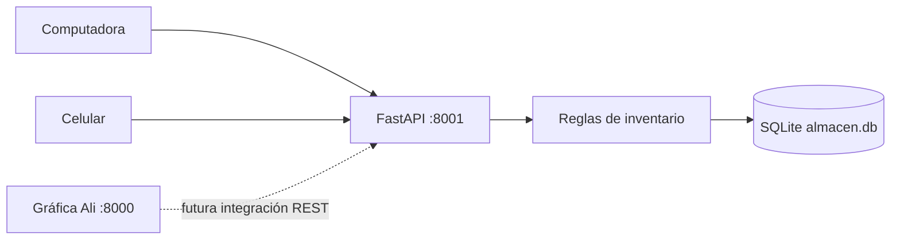

# Arquitectura e integración con Gráfica Ali

## Revisión del repositorio grafica_2

Referencia: `JhefersonJk/grafica_2`, `sistema_grafica_neon/repo`, revisión `cf2c35a`. El árbol contiene el sistema Python del taller, archivos de interfaz, documentación y pruebas. Se revisaron la estructura, la configuración, los contratos/modelos, las rutas de pedidos/caja/operaciones, la estrategia de migraciones y el arranque. No se inspeccionó el contenido de la copia de base de datos ni se escribieron archivos en el repositorio original.

- `main.py`: FastAPI y ciclo de vida, rutas de pedidos, clientes, notas, reportes, reloj.
- `database.py` y `models.py`: SQLAlchemy, SQLite, claves foráneas, sesiones; `migrations.py` amplía tablas sin destruir datos.
- `operations.py`, `order_rules.py`, `finance.py`, `finance_models.py`: reglas del trabajo, historial, archivos y contabilidad.
- `templates/` y `static/`: interfaz HTML/CSS/JS y GSAP locales. Python sirve HTML y API; JavaScript ejecuta las interacciones del navegador.
- El taller usa puerto 8000 y zona `America/La_Paz`. TintaStock usa 8001 por defecto y muestra tiempos en esa misma zona.

## Arquitectura de TintaStock 0.3

La base `data/almacen.db` se crea por separado, con tablas prefijadas `inventory_`. `inventory_revision` identifica la versión del catálogo. Cada escritura exige `X-Inventory-Revision`, comprobada dentro de `BEGIN IMMEDIATE`; saldo e historial se confirman juntos. El servidor rechaza conflictos, stock negativo y códigos duplicados. Se guardan cantidades en milésimas y costos en centavos para evitar errores binarios. Los documentos de respaldo conservan los identificadores, los datos históricos y los precios capturados al registrar cada movimiento.

El frontend de modo servidor no carga ni guarda el inventario en `localStorage`; solo conserva preferencias de interfaz. La página servida por FastAPI declara explícitamente su modo en un meta tag. No se conmuta silenciosamente a una base ficticia si la API falla. La lectura de la API se sincroniza cada 10 segundos cuando la pestaña está visible y no hay formularios activos, además de al recuperar conexión. `GET /api/state?since=<revisión>` devuelve 204 si no se necesita reenviar el inventario. Si una respuesta de guardado se pierde, la revisión evita duplicar automáticamente la operación. El piloto web estático sigue inequívocamente local.

## API REST

| Método | Ruta | Función |
|---|---|---|
| GET | `/api/health` | Estado del servidor |
| GET | `/api/state` | Estado coherente y revisión |
| GET | `/api/products?code=VIN-001` | Consulta de catálogo o código |
| POST / PUT | `/api/products`, `/api/products/{id}` | Alta y edición de material |
| POST | `/api/movements` | Movimiento validado |
| POST | `/api/products/{id}/remnants` | Separar sobrante |
| POST / PUT | `/api/orders`, `/api/orders/{id}` | Orden de trabajo |
| POST / PUT | `/api/suppliers`, `/api/suppliers/{id}` | Proveedor |
| PUT | `/api/backup/restore` | Restauración atómica, explícita |

## Siguiente integración

La tabla de órdenes de almacén reserva `workshop_order_id` para un vínculo futuro con el identificador real de pedido del taller. No se vinculan pedidos automáticamente ni se comparten archivos SQLite entre procesos. La integración recomendada es consultar `/api/orders/` del taller, seleccionar un pedido y guardar su ID explícito en el almacén, con una capa de autenticación y permisos. PostgreSQL se podrá evaluar cuando haya mayor concurrencia, pero hoy las transacciones SQLite son apropiadas para el piloto. La autenticación por cuentas y roles ya está implementada en 0.4. La conexión HTTPS del teléfono se configurará según el entorno real de instalación.

## Versión 0.4: usuarios y autorización

- Tablas independientes `inventory_users` y `inventory_user_sessions`; se crean al actualizar sin reemplazar el inventario existente.
- Contraseñas con scrypt y sal aleatoria; sesión opaca aleatoria con hash almacenado, cookie HttpOnly, SameSite=Strict, Secure cuando se usa HTTPS; caducidad de 12 horas. No se guardan credenciales en localStorage. Las escrituras requieren un encabezado propio de la aplicación y no se habilita CORS de terceros.
- Primera administración creada localmente con `python -m sistema_almacen.users --ensure`; no hay contraseña de fábrica ni endpoint público de registro. El gestor de usuarios se restringe a administración, y desactivar o cambiar una cuenta invalida sus sesiones.
- La autorización se aplica en las rutas Python. Administración controla todo, almacén opera existencias y etiquetas, producción registra solo retiros/devoluciones, gerencia consulta costos e informes. Los operarios reciben cifras de costo enmascaradas; la edición de material por almacén conserva el costo real. Se registra el usuario de sesión en movimientos nuevos.
- La interfaz usa un acceso simple, menú de cuenta y pantallas según rol; se conservan los temas claros/oscuros y el modo móvil. Los ajustes con nota opcional reemplazan la necesidad de registrar desperdicios como parte del flujo normal. La integración de las cuentas con el sistema de producción `grafica_2` sigue pendiente.
